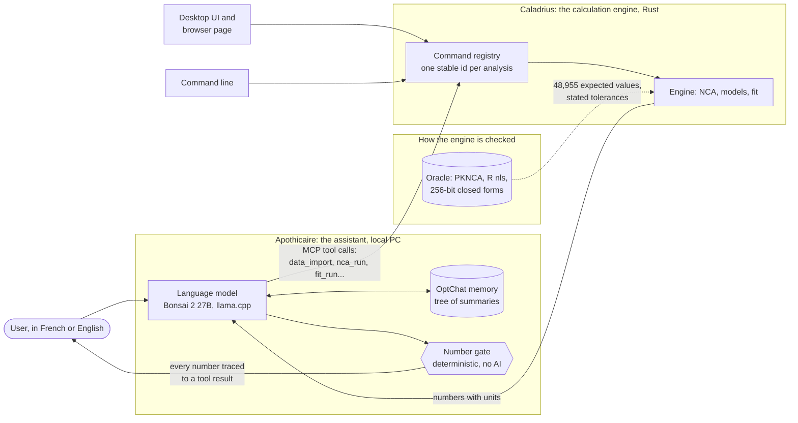

# History

How Caladrius was built, what went wrong along the way and what the status was on each date, as the README told it until 2026-10-29; the figures here are dated, and the current ones are in `docs/validation.md` and `docs/conformance.md`.

## In plain words, as it was written on 2026-10-29

**Who is building it, and why.** I am Abdallah (abdou-rgd on GitHub). I hold a Master's degree in health data science (Université Paris-Saclay) and I am now in the Master's programme in pharmacokinetic modelling at Université Paris Cité (PBPK and PK/PD modelling, population pharmacokinetics). I spent six months as a pharmacometrics intern at Sanofi R&D in Montpellier, evaluating and optimising population PK trial designs with Fisher information methods in NONMEM, and building an R/Shiny application to compare design outputs; that work received one of three awards at the Congrès Junior Pluridisciplinaire of Paris-Saclay and ENS in May 2026. I want to do a PhD at the meeting point of drug metabolism and pharmacokinetics (DMPK) and artificial intelligence. In my coursework the standard calculations are done in a commercial program that shows results but not its reasoning. Rebuilding them from textbooks, with a test for every rule, is how I make sure I understand them. The second reason is the question below: can a local AI be trusted with these numbers? To answer it honestly I needed a calculation engine whose every output I could verify. This repository is that engine, and the portfolio I show when I apply for internships and positions.

**How it fits with Apothicaire.** Apothicaire is the other half of the project: a DMPK assistant that runs entirely on one consumer PC (a single 12 GB graphics card; while it runs, nothing is sent to the cloud). It is not a chatbot. The language model (today Bonsai 2 27B, a "ternary" model from PrismML that fits the card; another small open model is a candidate to compare, Underdog Saluki 27B from Conway Research) is allowed to read the user's data, decide which calculation to run, call Caladrius, and explain the result. It is never allowed to compute a pharmacokinetic number itself. A deterministic check, written in plain Python and not learned, reads every answer and flags any number that does not come from a tool result or from the user: the model is asked once to write the answer again, and a warning badge is shown if a number is still unsourced. On a benchmark of 25 simulated exercises (200 questions), run twice on the same exercises, that check found 76 numbers out of 932 checked that came from no tool result in the model's first drafts (all 76 in the one question that tempts it to do arithmetic) and 0 out of 926 after the engine was given a `compare` command. These are counts on the 25 exercises the assistant was developed with (in-sample), one run and one sampling each, not a rate for other questions. The point of the design is that the AI is the part most likely to be wrong, so it is surrounded by deterministic, tested parts and by a check of every number it writes, which still misses a right number put on the wrong parameter.

**Why Rust.** Not for speed; these calculations are small. Rust was chosen because the compiler enforces the rules this project cares about. A value that may be missing must be handled where it appears. There is no garbage collector and no runtime to install, so the engine is one file that runs on Windows, Linux and a Mac, and the same code compiles to WebAssembly for the browser page. The project forbids every way of crashing on bad input (`unwrap`, `expect` and `panic!` are denied by the linter in every crate; indexing on slices and maps is denied by the linter in the four numerical crates (nca, models, fit, project) through `cargo xtask lint`, and checked in review elsewhere), so a malformed CSV or a non-estimable half-life gives a readable error, not a crash. Lastly, the layer rules (the numerical crates may not depend on the interface, the interface holds no numerical code) are checked by a command in the continuous integration, so the engine stays usable from a test, a terminal, an agent or a window alike.

**Why OptChat.** A conversation about a dataset can be long, and a 12 GB card cannot keep all of it in the model's context. OptChat is an idea by Victor Taelin: keep the whole chat on disk, and show the model a view where recent messages are verbatim and older ones are progressively merged into summary lines, arranged as a binary tree. Nothing is ever deleted, the view always covers the whole history, and the cost stays bounded. The prototype (<https://github.com/abdou-rgd/optchat>) recalled 8, 7 and 8 of 8 planted facts after 32 turns of filler, in three runs on the local model (the one miss was a loop of tool calls on one question, not a loss at compaction), which is why Apothicaire imports it unchanged.

**How it is built, and what went wrong.** The code is written by AI coding agents (Claude Code, with a DeepSeek agent as a second contributor) working under a written contract, `AGENTS.md`, with a task board in `board/` and a human who answers questions and decides what is published. The rules that matter most: no code is ever copied from the commercial software (it is written from textbooks, papers and public documentation, and any exposure to the commercial software's material is recorded in `specs/sources.md`); no change without a test; the conformance counts can only go up. The honest part is in the validation section below: one of the reference scripts was wrong once and the engine was right, and the repository records how that was found and fixed rather than hiding it in a tolerance.

**A guided tour.** `docs/explainer.html` is a self-contained page (no network, no library) that walks through the same story with a diagram, a toy concentration curve you can move, one question followed through the number gate, and a glossary. Download it and open it in a browser.

**Sources, tools and credits.** Everything the project stands on, with its license, is listed in `ATTRIBUTION.md` and `specs/sources.md`; the short version:

- Pharmacokinetics: Gabrielsson and Weiner, *Pharmacokinetic and Pharmacodynamic Data Analysis*; Gibaldi and Perrier, *Pharmacokinetics*; Rowland and Tozer, *Clinical Pharmacokinetics and Pharmacodynamics*; Bertrand and Mentré (2008) for the compartmental closed forms.
- Independent calculations the engine is checked against: `PKNCA` (Bill Denney and contributors), R and its packages `Rmpfr`, `expm`, `deSolve`, `minpack.lm`; the public `Theoph` and `Indometh` datasets shipped with R.
- Rust ecosystem: `egui`, `eframe` and `egui_plot` (Emil Ernerfeldt and contributors) for the interface, `wgpu` and `winit` for rendering and windows, `serde` for every command's parameters, and the rest of `Cargo.lock`.
- Model Context Protocol (MCP), the open protocol through which Apothicaire calls Caladrius.
- Apothicaire's model and runtime: Bonsai 2 27B and the PrismML fork of `llama.cpp` (Georgi Gerganov and the ggml contributors); Underdog Saluki 27B (Conway Research) as a candidate for comparison; the OptChat gist by Victor Taelin; the Liquid AI `d1` decision models considered for a small judge on the roadmap.
- The agents that wrote the code: Claude Code (Anthropic) and the DeepSeek Harness `dsh` (DeepSeek).
- The commercial reference software named in the trademark notice below is used in my coursework only; its results were compared once, privately, on counts, and nothing from it is in this repository.

## One oracle was wrong once, and why the tolerances differ

**One oracle was wrong once, and was corrected.** For the predicted-value weightings (`inv_yhat`, `inv_yhat2`) on Indometh, the engine and the first version of the R oracle disagreed on nine subject fits. The disagreement was recorded (`specs/differences.md`, D-02) instead of being absorbed into a tolerance, and was settled in task T-018: the engine's points were checked independently and upheld, while the oracle script had accepted degenerate "fixed points" (predictions of 1e-90) and missed real ones; the script was corrected and its cases regenerated. So the oracle is not infallible. It is now also checked by a naive Rust re-computation of every statistic and of the optimality condition `J' W r = 0` (`crates/caladrius-testkit/tests/step3_consistency.rs`), which is what would have caught the error.

**Why 1e-4 for fit parameters and 1e-6 for NCA.** NCA is closed arithmetic on the data, so two correct implementations differ only by rounding. A fit is a search: two optimizers stop at different points because of their stopping rules, and the engine's default derivatives are finite differences while the references use exact ones. The contract tolerance (1e-4) is a margin of caution, and the measured gaps are much smaller: over the 95 older reference fits the worst difference is 7.4e-6 on an estimate, 9.2e-6 on a standard error and 3.8e-7 on the residual sum of squares (the tolerance is about 14 times the worst on estimates, 11 times on standard errors, and only 2.6 times on the residual sum of squares), and on the five-point example, which is small enough to be worked on paper, the engine and R agree to 1e-6 on every statistic, and a test holds them to it (only the estimates are also tied to a second scripted recurrence; the other statistics are the engine against R). No tolerance has been loosened; the reasoning and the command that reproduces the figures are in `specs/fit.md` section 10.

## Status

Status (2026-10-29): NCA, one- and two-compartment models (with multiple dosing and steady state) and weighted least-squares fitting are checked against PKNCA, exact closed forms and R `nls`/`nlsLM` at stated tolerances (what is covered, and what is not, is in the section "What is verified, and what is not"); the conformance table holds 48955 of 48955 values (`docs/conformance.md`). A CLI and an MCP server expose every command, and the desktop application and the browser page share one interface: NCA, fit, simulation and plot pages, typed, pasted or imported data, project files, the command palette and settings. `v0.3.2` (2026-10-22) is the latest tag, with Linux and Windows binaries and the browser page (`docs/releases/`); on `main` since: a digest of the engine's answers that CI compares on Linux, Windows, macOS and WebAssembly, and a seal on every result (`docs/reproducibility.md`). See `AGENTS.md` for the contract and `board/INDEX.md` for the task board.

Named after the caladrius, the white bird of Roman legend said to take a sick person's illness away as it flies off.
