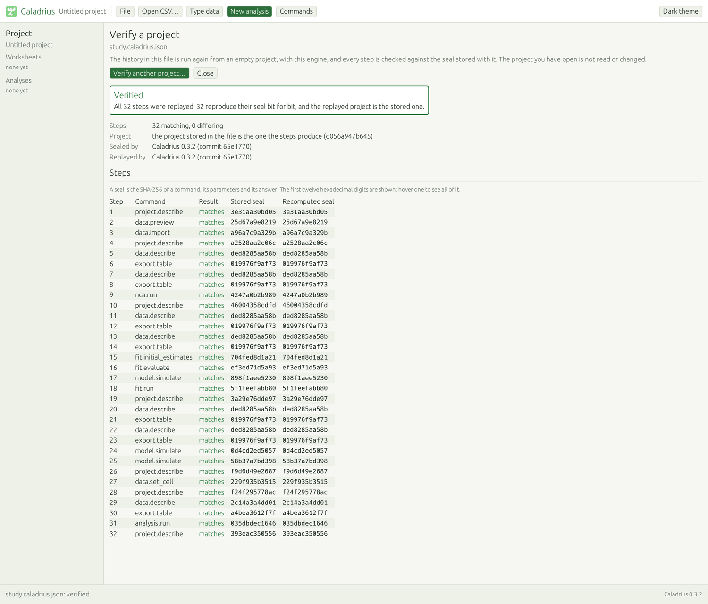

# Reproducibility

What Caladrius promises about its numbers, what it does not promise, and how anyone can check it without
trusting the person who made the result. It is written for a scientist who uses the program, not for
someone who reads Rust.

In short. The same command on the same data returns the same answer, digit for digit, on Linux, Windows,
macOS and in a web browser. Every answer carries a short fingerprint, a **seal**, so that two answers can
be compared without reading the numbers. A saved project keeps the history of the commands that made it,
and anyone can open the file and **replay** that history: the engine runs every command again and says
whether it obtains the same seals and the same project.

## What is guaranteed

### 1. The same digits on four kinds of machine

For one version of Caladrius, built with the Rust compiler pinned in `rust-toolchain.toml` (1.99.1) and
the maths library pinned in the manifests (`libm` 0.2.16), the engine returns the same answer, every digit
of every number, on:

- Linux, x86-64;
- Windows, x86-64;
- macOS, Apple silicon (arm64);
- WebAssembly, which is what the page in the browser runs (checked under Node.js 22).

This is not automatic. The standard maths functions of a programming language (exponential, logarithm,
powers) call the library of the operating system, and two libraries round the last digit differently. One
unit in the sixteenth digit looks harmless, but a fit can stop one iteration earlier because of it. Before
this was fixed, a third of the numbers of the test workload differed between Windows and the browser build,
most of them in the last digits and some much earlier, and the fit of one Indometh subject recorded 6
iterations on one machine and 5 on another. The numerical code now calls one pure Rust library for these
functions, the same code on every target, and the standard ones are banned by the linter (`clippy.toml`;
golden rule 10 of `AGENTS.md`). Additions, products, quotients and square roots are rounded
the same everywhere by the floating-point standard and stay as they are.

How it is checked. `cargo xtask digest` runs a fixed workload through the engine (the examples of every
command, the NCA and fit cases of the oracle, Theoph and Indometh under every weighting, model simulations,
inputs that must be refused, plots, and the replay of saved projects) and prints one SHA-256 of the text of
all the answers, last digits included. The `digest` jobs of CI run it on the four machines above, and the
job `digest-compare` fails the build when the four values are not the same.

### 2. A seal for every result

The seal of a command is the SHA-256 of a short text made of three things: the command (`nca.run`), the
parameters it received, and its answer, or the code of the error when it failed. The text is written one
way only, whoever writes it: keys in alphabetical order, no spaces, each number as the shortest text that
reads back as the same double, so the last digit is in the hash. SHA-256 turns it into 64 hexadecimal
digits; change one bit of one number anywhere in the parameters or in the answer and the seal is another.
Because the engine returns the same digits everywhere, the seal is the same everywhere: two people who run
the same command on the same data with the same engine can compare twelve characters instead of two
tables. The text and its format are in `crates/caladrius-engine/src/seal/mod.rs`.

Next to the seal, and not inside it, the program records where the seal was made: the version of the
engine, the git commit it was built from (when it was built from a checkout), the SHA-256 of the data the
command read (`input`: the text of the CSV for an import, the stored worksheets for the others) and the
time. They stay out of the hash on purpose: a later version that computes the same numbers has to give the
same seal. The engine has no clock of its own; the program that runs it gives it one.

Two commands carry no seal: `project.load` (the file it opens carries its own) and `project.replay` (it is
the check).

| Where | What you get |
|---|---|
| A saved project | each entry of `history` has an `at` time and a `seal` (`format`, `sha256`, `engine`, `commit`, `input`), unless the command carries none |
| `caladrius-cli` | a `seal` member in a JSON answer; above a CSV table, a first line `# caladrius engine=... commit=... command=... seal=... input=...`; `--no-seal` prints the answer as it is |
| The application | a plot saved as SVG carries the same line as an XML comment; "Verify a project" lists the seals of a file |
| The MCP server | in the `_meta` of each result (`caladrius/seal`, `caladrius/at`), never in the text the assistant reads |

`data.import` skips the stamp line of a CSV, so a table exported by Caladrius can be imported again. Other
programs have to be told to skip lines that start with `#` (`comment.char = "#"` in R, `comment="#"` in
pandas), or you take the line off, or you ask for no seal. The MCP server keeps seals out of everything
the assistant reads because a hash is a long run of digits and Apothicaire's number gate lets through only
numbers that come from a tool result: a seal is for the program that keeps the file, not for the model. The
three answers that would list seals of their own (`history_list`, `project_save`, `project_replay`) show
the assistant the same answer without them, and the whole answer is in `_meta` under `caladrius/result`.

### 3. Replay

Open a saved project where the engine is and ask it to verify. The engine starts from an empty project,
runs the commands of the history again in order with the parameters the history kept, and compares:

- each step: the seal it computes now against the seal stored in the file;
- the end: the project the steps produce against the project stored in the file.

A flipped bit shows in one of three places: in a parameter of the history (the step does not match), in a
result stored in the project (the project does not match), or in the engine (the first step it computes
differently). A replay reads no file and no clock, and the project you have open is not touched.



- **Application and web page.** `File`, `Verify a project...` (also in the command palette). Choose a file;
  the page says whether it reproduces and lists every step with its stored and recomputed seal, the first
  twelve digits and the whole seal on hover. A project saved on a Windows PC verifies in the browser on a
  Mac; the digest includes such a replay, which is how that is checked.
- **Command line.** `caladrius-cli project.replay --project study.caladrius.json` prints the report as JSON
  and a sentence on standard error, and exits with code 1 when something differs, so a script can use it.
- **MCP.** The tool `project_replay` takes a project (`project` or `text`); with no argument it replays the
  work of the session.

The verdict is one of five:

| Verdict | Meaning |
|---|---|
| Verified | every sealed step reproduces its seal, nothing was left out, and the replayed project is the stored one |
| Does not reproduce (`diverged`) | a step does not reproduce its seal, or the stored project is not the one the steps produce; the report names the first step and what differs |
| Incomplete | nothing differs, but some steps could not be run again (their parameters were too large to be kept, see below), so the check does not cover them |
| No seal to compare (`unsealed`) | a project saved before seals existed: the steps replay and the project matches, but there is nothing to compare bit for bit |
| Nothing to replay (`empty`) | the project has no history |

One way to see it work: change one digit of a concentration in the `csv` text of the first `data.import`
entry of the history of a saved project, then replay it.

```text
$ caladrius-cli project.replay --project edited.caladrius.json
diverged: Step 1 (data.import) does not reproduce its seal. 6 steps differ in all. Stored 11f0b61af21c, recomputed 12b4f3a1eb07.
```

(The digits depend on the file. The exit code is 1.)

## What a seal says, and what it does not

It says that a command, given these parameters, returned this answer, bit for bit, and that another engine
that computes the same bits gets the same seal. A verified replay says that the project file is exactly
what the commands of its history produce.

It does not say who made the file or when. A seal is a fingerprint, not a signature: anyone can run the
commands on other data and get another file that verifies. The time beside a seal is the clock of the
machine that ran the command, and nothing checks it. To tie a result to the data it started from, compare
the `input` of the import with the SHA-256 of the original file (`sha256sum data.csv` gives the same 64
digits when the file is read as it is).

It does not say that the method is right. That is the validation record (`docs/validation.md`): a seal says
the engine computed this, not that this is correct.

Caladrius makes no claim of regulatory compliance: a seal is a technical check, not an electronic signature
or a validated audit trail.

## What is not guaranteed

- **Other machines.** The check covers the four above. Other processors of the same families, other
  versions of Node.js or other browsers are not measured. Arithmetic that is rounded the same everywhere
  and one library for the rest give reason to expect the same digits; they are not a check.
- **Commands and options the workload does not reach.** The digest covers what its workload runs. The ban
  on the standard maths functions applies to all the numerical code, but a command or an option the workload
  never runs has no cross-machine check of its own.
- **The sign of a zero.** `min`, `max` and `clamp` may return either zero when they meet +0 and -0 (the Rust
  documentation says so), so an input of -0 can print as 0 on another processor. It predates seals, and the
  workload has no negative zero, so the digest cannot see it.
- **Very large options.** `usize` is 32 bits in WebAssembly: an option above 4 294 967 295
  (`max_iterations`, `n_curve`, `min_points`) is refused there with another message.
- **Another compiler or library version.** The promise is for the pinned ones. A new `libm` can round a
  function another way and changes the digest, so it is upgraded on purpose, with `docs/conformance.md`
  regenerated. When the engine that replays is not the one that sealed, the report says both versions and
  the replay can say "does not reproduce" at the first step whose numbers moved.
- **What is drawn.** The application draws curves, axes and ticks with the standard functions. What it
  stores, exports or sends to a command does not depend on them (reviewed in task T-111), and pixels are
  not part of the promise.
- **Large imports.** The history keeps the parameters of a command up to 64 KiB. An import above that keeps
  its size and a short fingerprint (FNV-1a, not a cryptographic hash) instead of its text, so it cannot be
  run again from the file alone: the verdict is Incomplete, and the steps that depend on it are not run. The
  `input` hash of the import is kept in its seal, so the original file can still be checked against it.
- **A project opened in the middle of a history.** When the history says that a project was opened from a
  file whose content it did not keep, the replay takes the project the earlier steps made as that project,
  says so in its summary, and the comparison at the end still checks everything that follows.
- **A history that was taken out.** The history holds the data of the project (README, "Usage"). A project
  without it, for example one made anonymous by removing the `history` array, loads and works but has
  nothing to replay.
- **Another seal format.** A seal that is not of format 1 is not recomputed, and the step says so.
- **The time.** It is not in the seal and nothing checks it.
- **Long histories.** A replay runs on the thread of the window or of the page: while a history of hundreds
  of fits is replayed, the window or the tab does not respond.

## Check it yourself

```sh
cargo xtask digest            # the SHA-256 of the answers of the fixed workload
cargo xtask digest --wasm     # the same workload in WebAssembly under Node.js (needs wasm-bindgen and Node)
```

CI prints the four values of a change in the summary of the job `digest-compare`.

```sh
# the same command on two machines: the `seal.sha256` of the answer is the same
caladrius-cli nca.run --csv oracle/data/theoph.csv --param route=extravascular --param subject=1

# a project, kept between calls, then verified (exit code 0, or 1 when it does not reproduce)
caladrius-cli nca.run --csv oracle/data/theoph.csv --param route=extravascular --project study.caladrius.json
caladrius-cli project.replay --project study.caladrius.json
```

In the application or in the web page: `File`, `Verify a project...`, then the file.
